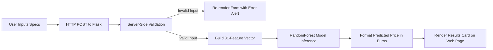

# LaptopValue AI — Laptop Price Prediction Application

An educational machine learning web application that estimates laptop market prices based on hardware specifications using a trained Random Forest Regressor and Flask.

---

## 1. Project Objective

The goal of this project is to predict laptop market prices based on core technical specifications (processor tier, memory capacity, graphics architecture, operating system, chassis form factor, display technology, and weight). 

This project adapts and refines an existing open-source repository (`Laptop-Price-Predictor`) by hardening the Python/Flask backend, ensuring robust input validation, and providing an understated, presentation-ready user interface suitable for academic evaluation and viva demonstration.

---

## 2. Key Features

- **Model-Driven Estimation**: Utilizes a trained `RandomForestRegressor` with 50 estimators, tuned via `GridSearchCV`.
- **Clean, Professional UI**: Built with responsive vanilla CSS adhering to modern hardware catalog design (warm off-white canvas, charcoal text, slate-blue accents, no distracting animations or neon gradients).
- **Instant Response**: Zero artificial loading delays or unnecessary client-side bloat.
- **Server-Side Input Validation**: Validates numerical ranges (RAM: 2–128 GB, Weight: 0.5–10.0 kg) and prevents malformed requests or invalid categories from crashing the server.
- **Form State Persistence**: Retains user selections upon submission or validation errors so values do not need to be re-entered.
- **Graceful Error Handling**: Displays human-readable alert messages instead of raw Python tracebacks or filesystem paths.
- **Realistic Context & Disclaimers**: Clarifies dataset scope (European retail catalog listings in Euros, without physical condition or battery health data).

---

## 3. Technologies Used

| Technology | Role & Purpose |
| :--- | :--- |
| **Python 3.14** | Core programming language executing backend logic and ML inferences. |
| **Flask 3.1** | Lightweight WSGI web framework serving HTML templates and routing HTTP GET/POST requests. |
| **Scikit-Learn 1.9** | Machine learning library used for running inference with the trained `RandomForestRegressor` model. |
| **Pandas 3.0** | Data manipulation library used to structure feature inputs into expected named dataframes. |
| **NumPy 2.5** | Numerical computing library handling array operations and numeric rounding. |
| **Jinja2** | Template engine rendering dynamic prediction values, error banners, and form states into HTML. |
| **HTML5 & CSS3** | Clean semantic structure and responsive, restrained styling without external CDN dependencies. |
| **Jupyter Notebook** | Interactive environment used during initial data exploration, model training, and hyperparameter tuning (`model/price_predictor.ipynb`). |

---

## 4. Project Folder Structure

```text
laptop-price-prediction/
│
├── app.py                      # Root launcher script (runs Flask on http://127.0.0.1:5000)
├── requirements.txt            # Python dependencies (Flask, scikit-learn, pandas, numpy)
├── README.md                   # Comprehensive project documentation
├── PRESENTATION_NOTES.md       # Viva preparation guide and likely examiner Q&A
├── vercel.json                 # Optional Vercel deployment configuration
│
├── model/                      # Model training resources
│   ├── laptop_price.csv        # Dataset (1,303 laptop records, Latin-1 encoded)
│   ├── laptop_price_predictor.pickle # Serialized trained RandomForestRegressor
│   └── price_predictor.ipynb   # Jupyter notebook containing training pipeline
│
└── WebApp/                     # Flask Web Application package
    ├── app.py                  # Core Flask application, validation, and inference routes
    ├── model/
    │   └── laptop_price_predictor.pickle # Production model replica for direct WebApp execution
    ├── static/
    │   └── style.css           # Custom understated design system (responsive CSS)
    └── templates/
        └── index.html          # Semantic HTML5 template with form, result card, and about section
```

---

## 5. How the Prediction Workflow Works



1. **User Input**: The user enters hardware specifications (brand, chassis category, CPU family, GPU provider, RAM in GB, weight in kg, OS, and display flags) on the web form.
2. **Form Submission**: Clicking **Estimate price** sends an HTTP POST request to `/`.
3. **Validation**: Flask checks that numerical values fall within realistic physical limits and that categorical selections match valid model classes.
4. **Feature Encoding**: The backend maps the inputs into a 31-element vector matching the exact one-hot encoding structure produced during training.
5. **Model Inference**: The loaded `RandomForestRegressor` predicts the price value (`Price_euros`).
6. **Display**: The predicted price is rounded, formatted with currency symbols (€), and rendered alongside a summary of the evaluated specifications.

---

## 6. How the Model Was Trained (Notebook Audit)

Based on the actual Jupyter Notebook (`model/price_predictor.ipynb`):

1. **Dataset Loading**: 1,303 laptop records loaded with `encoding='latin-1'`.
2. **Feature Cleaning & Engineering**:
   - `Ram`: Stripped `"GB"` string suffix and cast to integer.
   - `Weight`: Stripped `"kg"` string suffix and cast to float.
   - `ScreenResolution`: Extracted binary flags `Touchscreen` (1/0) and `Ips` (1/0).
   - `Cpu`: Simplified to first 3 words, grouped into `Intel Core i7`, `Intel Core i5`, `Intel Core i3`, `AMD`, and `Other`.
   - `Gpu`: Extracted first word (`Intel`, `AMD`, `Nvidia`). One outlier record with GPU `ARM` was dropped (1,302 remaining).
   - `Company`: Rare brands (Samsung, Razer, Xiaomi, etc.) grouped into `'Other'`.
   - `OpSys`: Grouped into `Windows`, `Mac`, `Linux`, and `Other`.
   - Unused raw columns dropped: `laptop_ID`, `Inches`, `Product`, `ScreenResolution`, `Cpu`, `Gpu`.
3. **One-Hot Encoding**: Applied `pd.get_dummies()` to categorical columns, yielding **31 total input features**.
4. **Data Splitting**: 75% training (976 rows) and 25% testing (326 rows) via `train_test_split(test_size=0.25)`.
5. **Algorithms Evaluated**:
   - **Linear Regression**: $R^2 \approx 0.677$ (67.7%)
   - **Lasso Regression**: $R^2 \approx 0.681$ (68.1%)
   - **Decision Tree Regressor**: $R^2 \approx 0.525$ (52.5%)
   - **Random Forest Regressor**: $R^2 \approx 0.708$ (70.8%)
6. **Hyperparameter Tuning**: `GridSearchCV` evaluated combinations of `n_estimators` `[10, 50, 100]` and `criterion` `['squared_error', 'absolute_error', 'poisson']`.
7. **Best Model**: `RandomForestRegressor(n_estimators=50)` achieved the highest test $R^2$ score of **$0.716$ (71.6%)** and was serialized to `laptop_price_predictor.pickle`.

---

## 7. Dataset Description & Real-World Limitations

- **Dataset File**: `model/laptop_price.csv`
- **Total Records**: 1,303 rows, 12 columns
- **Target Variable**: `Price_euros` (retail listing price in Euros)
- **Price Range**: Min €174.00, Median €977.00, Mean €1,123.69, Max €6,099.00
- **Limitations**:
  - The dataset represents catalog retail listings at the time of data collection.
  - It does **not** include device age, release year, battery charge cycle count, or cosmetic wear.
  - Predictions represent a **statistical baseline estimate** for new/catalog hardware configurations, **not** an appraisal for used or second-hand resale.

---

## 8. Installation & Setup (Windows)

### Prerequisites
- Python 3.9 through 3.14 installed on your Windows machine.
- Git (optional, if cloning from repository).

### Step 1: Clone Repository and Navigate to Project Directory
```powershell
git clone https://github.com/SWA-YAM109/laptop-price-prediction.git
cd laptop-price-prediction
```

### Step 2: Create and Activate a Virtual Environment
```powershell
python -m venv venv
.\venv\Scripts\Activate.ps1
```
*(If script execution is disabled in PowerShell, run `Set-ExecutionPolicy -Scope Process -ExecutionPolicy Bypass` first).*

### Step 3: Install Required Packages
```powershell
pip install -r requirements.txt
```

---

## 9. Starting the Application

Run the application launcher from the project root:

```powershell
python app.py
```

You will see output similar to:
```text
Starting Laptop Price Predictor server on http://127.0.0.1:5000 ...
 * Serving Flask app 'WebApp.app'
 * Debug mode: on
 * Running on http://127.0.0.1:5000
```

---

## 10. Opening the Application in Your Browser

Open your browser and navigate to:
```
http://127.0.0.1:5000
```
or
```
http://localhost:5000
```

---

## 11. Troubleshooting Common Issues

### Issue 1: `InconsistentVersionWarning` on unpickling
- **Cause**: The pickle file was originally created with scikit-learn 1.3.2, whereas newer environments may run scikit-learn 1.4+.
- **Fix**: The application includes explicit forward compatibility patches (`monotonic_cst` attribute initializers) inside `WebApp/app.py`. The model loads and runs inference normally despite the warning.

### Issue 2: `FileNotFoundError: Model file not found`
- **Cause**: Running Python from a different working directory.
- **Fix**: The application resolves paths dynamically relative to `__file__`, checking both `WebApp/model/` and `../model/`. Always ensure the pickle file exists in at least one of these locations.

### Issue 3: `Port 5000 already in use`
- **Cause**: Another process or background instance of Flask is already running on port 5000.
- **Fix**: Stop the previous process or edit line 14 of `app.py` to use an alternate port (e.g. `port=5001`).

---

## 12. How to Demonstrate the Project in a Viva / Presentation

1. **Start the Application**: Run `python app.py` and open `http://127.0.0.1:5000`.
2. **Explain the Interface**: Point out the clean layout, logical specification groups (Chassis, Processor, Graphics, Memory, Display), and responsive design.
3. **Demonstrate a Baseline Prediction**:
   - Brand: **HP**
   - Category: **Notebook**
   - Processor: **Intel Core i5**
   - Graphics: **Intel**
   - RAM: **8 GB**
   - Weight: **1.86 kg**
   - OS: **Windows**
   - IPS: **Checked**
   - Click **Estimate price** $\rightarrow$ Show the estimated price (€785.70).
4. **Demonstrate High-End Specs Comparison**:
   - Change Brand to **Dell**, Category to **Gaming**, Processor to **Intel Core i7**, Graphics to **Nvidia**, RAM to **16 GB**, Weight to **2.4 kg**.
   - Click **Estimate price** $\rightarrow$ Show how the price increases significantly (€1,417.31) reflecting gaming hardware premiums.
5. **Demonstrate Robust Validation**:
   - Change RAM to `999` or leave a required field empty.
   - Click **Estimate price** $\rightarrow$ Highlight that the application displays a friendly red alert banner without crashing or showing an ugly error stack trace.
6. **Refer to the About Section**: Scroll down to explain the model architecture (Random Forest, $R^2 \approx 71.6\%$), dataset scope (1,303 rows in Euros), and real-world limitations.
